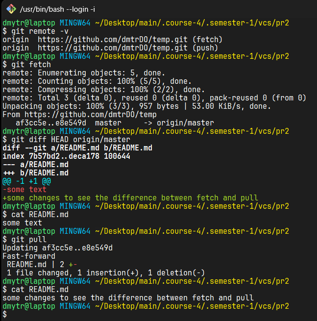
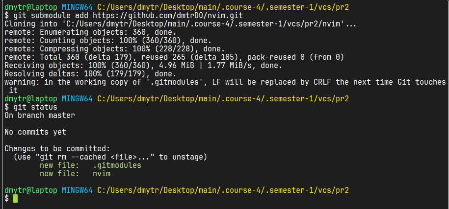
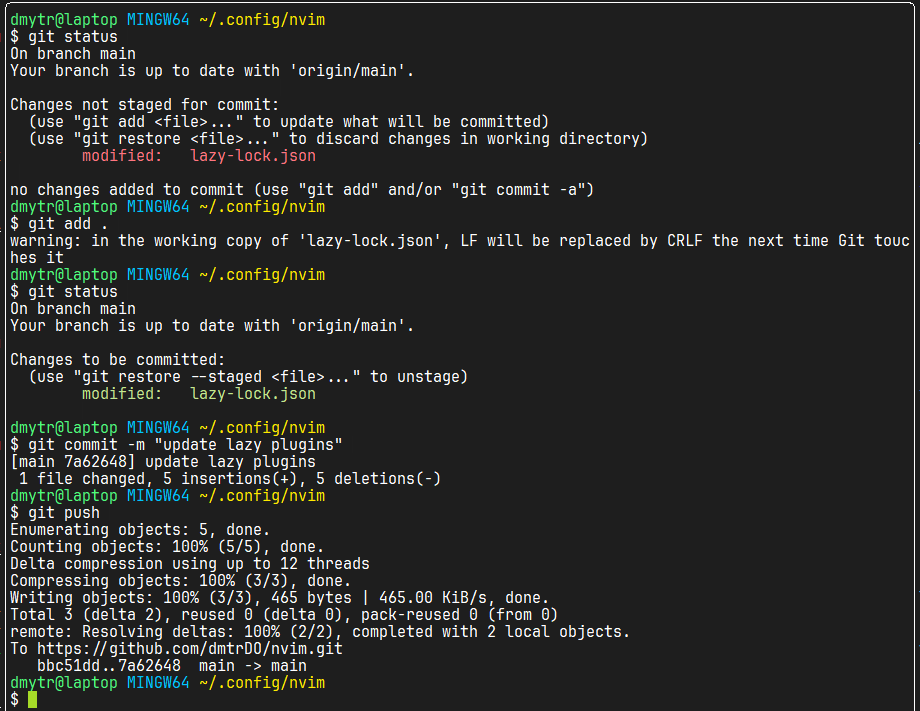
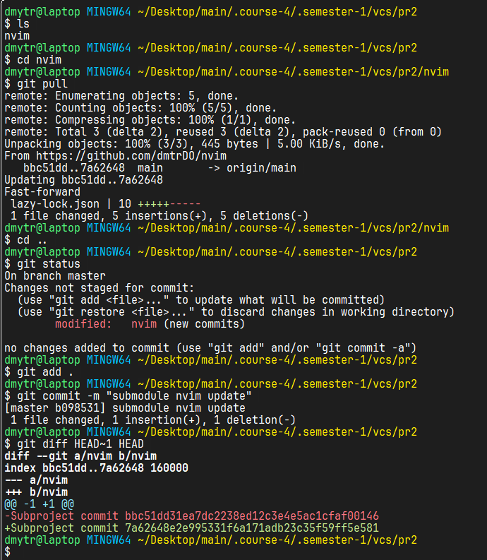
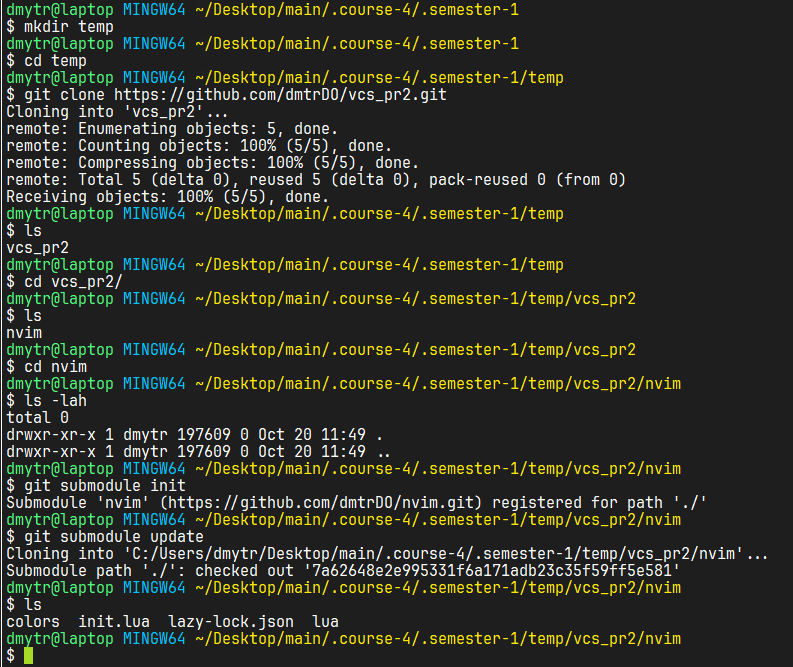
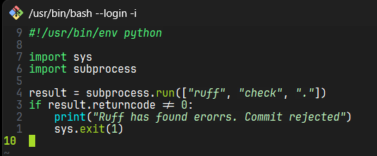
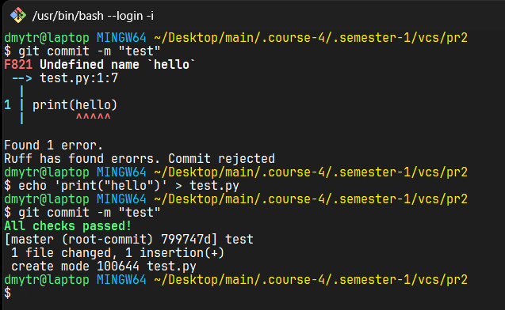

# Практична робота №2

## Робота з віддаленим репозиторієм

Для початку створимо пустий репозиторій на github наступно командою:  
```
gh repo create --public temp
```
тепер додамо його як origin до локального репозиторію наступною командою:
```
git remote add origin https://github.com/dmtrDO/temp.git
```
додамо тепер readme-файл і зробимо push:
```
git add README.md
git commit -m "initial commit"
git push -u origin master
```
Прапорець ```-u (--set-upstream)``` - створює зв'язок між головною гілкою віддаленого репозиторію origin і локальною гілкою master.

Тепре на самому гітхабі можна зробити якісь зміни, наприклад змінити README.md і застосуємо fetch/pull (рисунок 1).


Рисунок 1 - Застосування fetch/pull

Команда ```git fetch``` - підтягне зміни але вони не застосуються до робочих файлів, а ось ```git pull``` - виконує ```fetch``` і робить злиття.


## Використання підмодулів (submodule)

Підмодулі потрібні для того, щоб в проєкті використовувати інші бібліотеки і залежності. Тобто ми вбудовуємо один git-репозиторій в всередину іншого як піддиректорію. При чому головний проєкт зберігає не самі файли залежностей, а лише посилання на конкретний коміт.

Додамо до проєкту підмодуль (наприклад, nvim) (рисунок 2) командою  

```
git submodule add https://github.com/dmtrDO/nvim.git
```


Рисунок 2 - Додавання підмодуля

Якщо розробник цієї бібліотеки зробив якісь зміни (рисунок 3), то ми завжди можемо їх синхронізувати командою ```git pull``` і оновити його в головному репозиторію через ```git add -> git commit``` (рисунок 4).  



Рисунок 3 - Розробник вніс зміни до залежності, яку ми використовуємо


Рисунок 4 - Оновлюємо залежність командами pull, add, commit

Для того, щоб інші розробники теж могли завантажити собі залежності (якщо вони просто клонують репозиторій, то підмодуль створюється, але він пустий), вони можуть використати команду ```git submodule init```, яка копіює налаштування підмодуля з файлу ```.gitmodules``` у локальний файл конфігурації ```.git/config```, а командою ```git submodule update``` завантажити вміст підмодуля з віддаленого репозиторія (рисунок 5).


Рисунок 5 - Використання git submodule init/update


## Автоматизація перевірок перед комітом (pre-commit hook)

Створимо скрипт (pre-commit), який запускає лінтер (наприклад, ruff для python), який не дозволить зробити коміт, якщо виявлено помилку стилю (рисунки 6, 7).


Рисунок 6 - Створення git-хука, який запускає pre-commit скрипт


Рисунок 7 - Перевірка pre-commit


