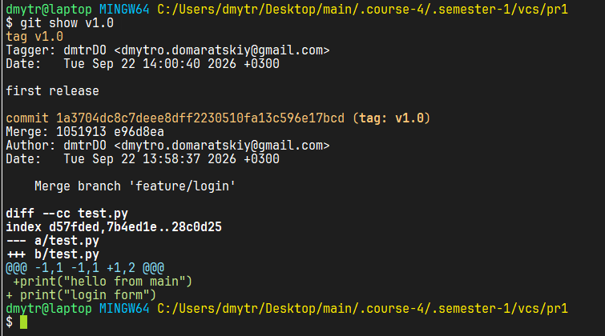

# Практична 1

## git init

Створює початковку папку .git

## git add

Додає файли до stage (щоб вони стали відстежувані і їх можна було зберігати через commit)  
Можна і через крапку `.` - додасть усі файлу до stage в поточній директорії, а можна і окремо кожен файл, наприклад **git add `README.md`**.

## git commit

Після того, як ми додали файл до stage, ми можемо зробити коміт, щоб зберегти конкретну версію програми через `git commit -m "some message"`

## branches

Ми можемо створювати гілки за домогоюо `git branch`, наприклад `git branch feature/login`  
Тепер перейдемо в feature/login за допомогою `switch`, або `checkout`  
Я використовую `switch`, бо його спецально створили з упором на інтуїтивно зрозумілішу команду, і також можна створити гілку і одразу в неї перейти за домогою `switch -c feature/login`, тут прапорець `-c` більш зрозуміліший від **create**, натомість з попередньою командою `checkout -b feature/login`.  

## merge && rebase
Наприклад у нас є наступний сценарій гілок (є головна гілка **main** і в якийсь момент ми захотіли додати форму логіну для додатку і для цього ми окремо створили **feature/login**) і теж зробили в ньому якісь коміти:

```
main ---- A ----- B ---------- C --------- E ---
                         |
                   feature/login --- D --- F ---

```
Головна різниця між ними полягає в тому, що **`merge`** зливає два останніх коміти з двох гілок, в даному випадку відбудеться спроба злити коміти `E` і `F`, відповідно якщо буде конфлікт, то це треба буде випарвити, зберегти файл, додати до `stage` і продовжити злиття через `git merge continue`, і буде щось наступне: 


```
main ---- A ----- B ---------- C --------- E --- M (E & F) -----
                         |
                   feature/login --- D --- F -------------------

важилво зазначити, що merge ми робио з гілки,
в яку ми хочему злити зміни з іншої гілки
```

а **`rebase`** в свою чергу бере коміти `D` і `F`, висмикує їх тимчасово з `feature/login` оновлює цю гілку до останнього коміта в головній гілці `main` і після цього застосовує збережені коміти поверх цього і у нас виходить наступне:  

```
main ---- A ----- B ---------- C --------- E ---------------
                         |
                   feature/login --- C --- E ---- D --- F ---

тут ми виконуємо команду з гілки яку хочемо оновити до
головної і потім застосувати коміти поточної гілки
```

## tags

Теги, в часності, анотовані теги найчастіше використовують для позначення релізів програми/застосунку/системи.  
Наприклад можна створити тег за допомогою `git tag -a v1.0 -m "first release`, і переглянути інформацію про нього через `git show v1.0`:


Тут ми можемо побачити метадані, наприклад автора, дату, повідомлення, назву, і коміт, на основі якого було створено тег/мітку, і далі вміст, а саме зміни з попереднього тегу, в даному випадку з моменту ініціалізації `git`.

